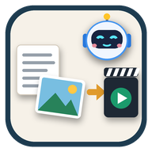

# 小柯機器人文字與圖像轉影音工具

https://github.com/user-attachments/assets/f7d23d3f-21fb-4209-a80b-2aa75f40ce67

一篇**故事文案**＋角色的**九宮格視圖**（1～10 位：主角、配角、童星）→ AI 依故事安排**遠景、中景、近景、特寫**，
做出**接近真實拍攝**的鏡頭影片（光源、廣角、色溫依真實光線特性）、**依性別與年齡區分**的自然配音（遠近、大小依場景），
最後合成 MP4，並產生 **SRT 逐字稿**。

## 下載

| 平台 | 狀態 |
|---|---|
| Windows 11 | ✅ v1.3.0（[Releases](https://github.com/achir1015/xiaoke-storyvideo/releases/latest)） |
| MacBook Pro（Apple 晶片／Intel） | ✅ v1.3.0（[Releases](https://github.com/achir1015/xiaoke-storyvideo/releases/latest)；第一次開啟若被擋：按右鍵 →「打開」，或到「系統設定 → 隱私權與安全性」按「強制打開」） |
| 線上版（HTML） | ✅ <https://achir1015.github.io/xiaoke-storyvideo/>（免安裝；專案存在瀏覽器裡，影片在瀏覽器合成，較慢） |
| iPhone／iPad（線上安裝） | 規劃中 |
| Android | 規劃中 |

## 五個步驟

1. **故事文案**：貼上或開啟 .txt／.docx／.md。敘述 → 旁白；「」裡的話 → 角色台詞。
2. **角色九宮格**：每位角色一張 3×3 九宮格（正面、左側、右側、四分之三側、背面、遠景、中景、近景、面部特寫）。
   沒有圖？加 1～3 張照片或寫外觀，按「**AI 產生九宮格**」。
3. **分鏡腳本**：AI 導演自動分鏡，寫好鏡頭、光源、色溫（K）、焦段（mm）、運鏡、環境音與每句台詞，全部可修改。
4. **畫面與配音**：AI 依九宮格拍出寫實畫面，再演成影片（含現場環境音）；配音依角色性別年齡設計專屬聲音，遠景較小聲有空間殘響、特寫貼近清楚。
5. **合成影片・SRT**：一鍵合成 MP4（可燒錄字幕、內嵌字幕軌），同時存一份 SRT。

## AI 服務（預設全部免費）

| 功能 | 免費（預設） | 付費（選用） |
|---|---|---|
| 分鏡 | Gemini 文字模型（[Google AI Studio](https://aistudio.google.com/apikey) 的**免費金鑰**即可）；沒有金鑰就依段落與對白快速切段 | — |
| 鏡頭畫面 | **免費雲端 AI**（[AI Horde](https://aihorde.net)，全球志工電腦產生寫實照片，免帳號、要排隊，每張約 1–8 分鐘）；或直接用九宮格照片 | Gemini 圖片模型（Nano Banana） |
| 動態 | **2.5D 立體動態照片**：AI 判斷畫面遠近（Depth Anything，CPU 計算），做出立體視差的推、拉、搖運鏡 | Gemini Omni AI 影片（3–15 秒/鏡，含環境音，依秒數計費） |
| 配音 | **微軟神經語音**（台灣腔，分男女老少；只有桌面版）；**台灣口音雲端語音**（[IndexTTS](https://huggingface.co/spaces/IndexTeam/IndexTTS-2.5-Demo) 免費雲端 GPU，用台灣人聲音樣本、會表現語氣；線上版預設，建議貼免費的 Hugging Face 權杖） | Gemini 聲音設計（每角色專屬） |

金鑰貼在程式右上角「⚙ 設定」，只存在你的電腦（桌面版用系統加密；線上版存在這個瀏覽器）。付費的 AI 影片產生前會先顯示總秒數讓你確認。

免費雲端畫面與立體動態照片都不會讓電腦的顯示晶片長時間滿載。設定裡另有「本機小模型分鏡」實驗功能（在自己電腦用顯示晶片跑 AI），預設關閉：部分筆電長時間滿載會過熱或當機重開。

專案存在「文件\小柯文字圖像轉影音\專案名稱」，裡面有 角色／鏡頭／語音／輸出 資料夾與 project.json。

---

開發：吳玉柱 先生 與 Claude AI Opus 5.5　・　授權：MIT（內附 FFmpeg 為 GPL，見 THIRD_PARTY_NOTICES.md）

## 線上版說明

- 打開網址就能用，不用安裝；專案、圖片、配音、影片都存在**這個瀏覽器**裡（換瀏覽器或清除網站資料就看不到）。做好的影片按「⬇ 下載影片」存到電腦。
- 合成用 ffmpeg.wasm 在瀏覽器裡跑，比桌面版慢（約 5～10 倍）；第一次會下載約 30 MB 的 FFmpeg 和 6 MB 的中文字幕字型。
- 微軟語音不允許網頁直接連線，線上版配音改用台灣口音雲端語音或 Gemini 語音。
